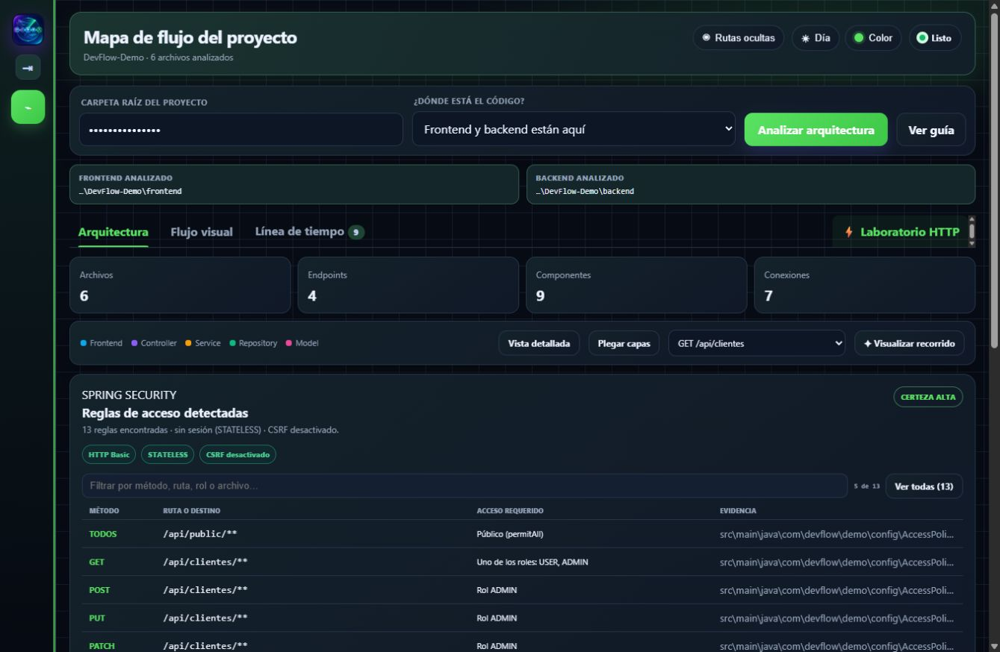
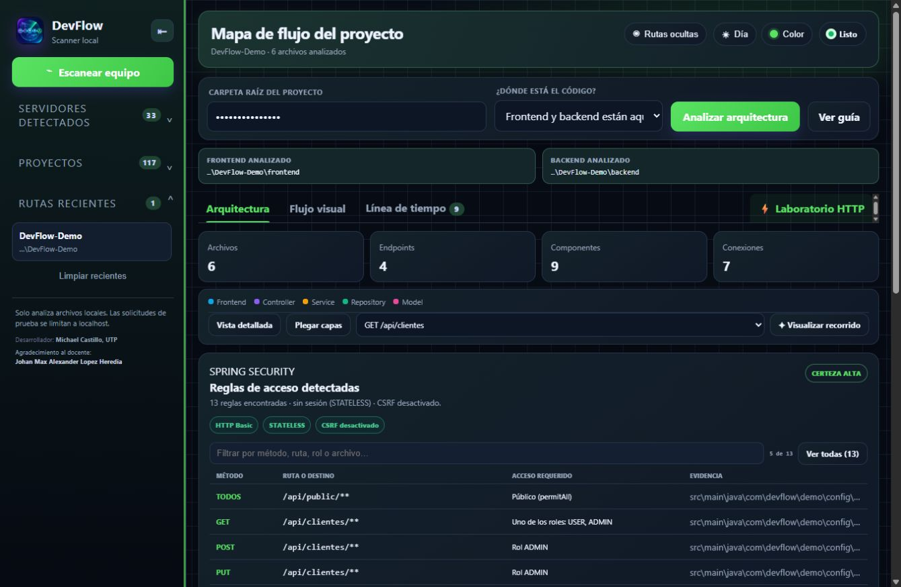
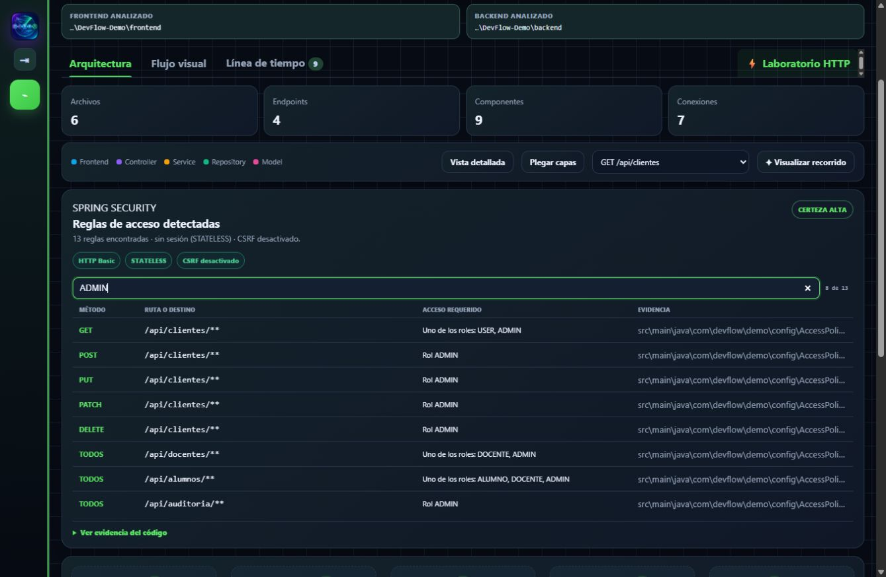
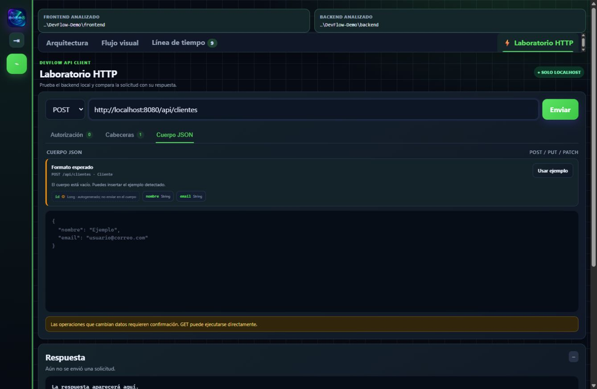
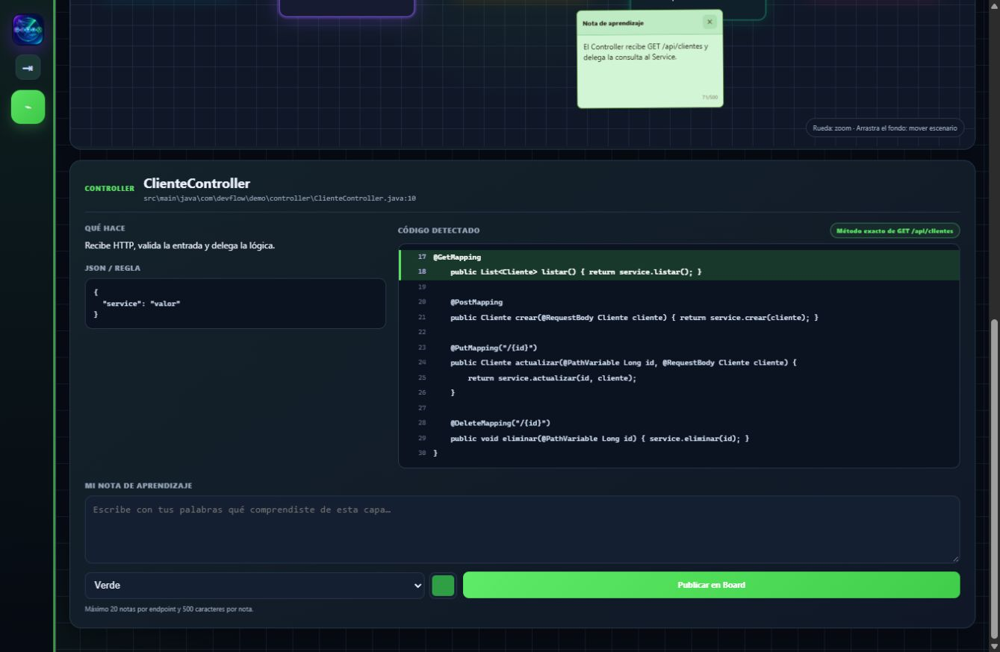

# DevFlow Scanner para VS Code

Extensión visual educativa para comprender el recorrido de la información entre:

`Frontend → Controller → Service → Repository → Model`

## Funciones

- Detección de proyectos y servidores locales.
- Mapa visual de arquitectura.
- Detección de llamadas frontend y endpoints Spring.
- Visualización del archivo fuente completo.
- Recorrido persistente de endpoints sin desplazar automáticamente la pantalla.
- Panel interactivo **Flujo visual** para iluminar y estudiar cada recorrido.
- Board con zoom, encuadre, tablas y notas movibles sin límites direccionales.
- Notas con colores rápidos y selector de cualquier color.
- Laboratorio HTTP con autorización Bearer JWT, cabeceras y cuerpo JSON.
- Autenticación HTTP Basic y editor de cabeceras personalizadas.
- Análisis educativo de reglas Spring Security, roles, mecanismos y evidencia del código.
- Detección de `@GeneratedValue` y exclusión de IDs autogenerados en los ejemplos de solicitud.
- Guía automática de DTO, campos requeridos, validaciones y ejemplos JSON para endpoints Spring.
- Explicaciones prácticas para errores HTTP comunes, incluidos 400, 401, 403, 404, 415 y 500.
- Laboratorio HTTP limitado a `localhost`.
- Línea de tiempo de solicitudes.
- Temas claro/oscuro y personalización de color.
- Detección automática de actualizaciones publicadas en GitHub.
- Modo privacidad reversible y rutas recientes plegables en el panel izquierdo.
- Revisión de repositorios públicos de GitHub antes de clonarlos.
- Selector de ramas para previsualizar y clonar exactamente la rama elegida.
- Lectura educativa inicial de archivos PHP y rutas Laravel.

## Novedades de DevFlow 1.5.2

- Añade un buscador compacto para filtrar endpoints por método, ruta, componente o rol.
- Permite navegar y seleccionar resultados con el teclado, agrupados por controller.
- Mantiene activa la iluminación del recorrido al filtrar o cambiar de endpoint.
- Mejora el espaciado y la adaptación a distintos anchos de VS Code.
- Añade estados de carga y una capa de animaciones opcional sin bloquear la interfaz.
- Refuerza los diagnósticos educativos para respuestas HTTP correctas, 401 y 404.

## Novedades de DevFlow 1.5.1

- Muestra la identidad activa durante las pruebas del Laboratorio HTTP.
- Relaciona usuarios HTTP Basic declarados en Spring Security con sus roles estáticos.
- Mantiene visible `Usuario` y `Rol` al trabajar en Autorización, Cabeceras o Cuerpo JSON.
- Informa `Rol: No confirmado` cuando los permisos proceden dinámicamente de una base de datos.
- Extrae la identidad y los roles declarados dentro de JWT sin afirmar que su firma fue validada.
- Nunca muestra ni almacena las contraseñas analizadas.

## Novedades de DevFlow 1.5.0

- Verifica una URL pública de GitHub y muestra su árbol de archivos sin modificar el repositorio.
- Detecta hasta 1000 ramas y permite cambiar la vista previa entre ellas.
- Clona únicamente la rama elegida en una carpeta seleccionada desde VS Code.
- Después de clonar, abre la ruta como proyecto local y habilita Arquitectura, Flujo visual, Línea de tiempo y Laboratorio HTTP.
- Corrige la reactivación de la iluminación del Board con el mismo botón.
- Añade soporte inicial para PHP y Laravel.

## Vista rápida de DevFlow

### Arquitectura y Spring Security

### Modo privacidad y rutas recientes

### Filtro para configuraciones con muchas reglas

### Laboratorio HTTP

### Flujo visual y notas de aprendizaje

## Descarga

Descarga el archivo correspondiente desde la sección **Releases**:

- Windows x64: `DevFlow-Scanner-win32-x64-1.5.2.vsix`
- Mac Apple Silicon: `DevFlow-Scanner-darwin-arm64-1.5.2.vsix`
- Mac Intel: `DevFlow-Scanner-darwin-x64-1.5.2.vsix`

La versión Windows superó la prueba automática del paquete. Las compilaciones de macOS requieren validación final en una Mac real.

## Instalación

En VS Code abre **Extensiones → … → Instalar desde VSIX...** y selecciona el archivo descargado. Después ejecuta **DevFlow: Abrir Scanner** o pulsa **DevFlow** en la barra de estado. Para comprobar manualmente una versión nueva usa **DevFlow: Buscar actualizaciones en GitHub**.

Desarrollador: **Michael Castillo**

Agradecimiento al docente: **Johan Max Alexander Lopez Heredia**
